# Next.js の Storybook 追加漏れを Storymesh で見つける — 導入から UI 状態の検査まで

Next.js と React で UI を作っていると、コンポーネントを追加したのに Storybook の Story を書き忘れることがあります。さらに、Story ファイルがあっても Loading などの必要な状態が抜けていることがあります。

Storymesh はこの二つを別のコマンドで確認できます。`check` はコンポーネントに対応する Story **ファイル**を探し、`spec check` は YAML で要求した UI 状態が Storybook の **index に登録されているか**を確認します。この記事では実際の Next.js サンプルに npm 版を導入し、不足を検出してから解消するまでを試します。

## 今回の実行環境と成果物

| 項目 | 実行したバージョン |
| --- | --- |
| OS | macOS / Apple Silicon |
| Node.js | 24.18.0 |
| Next.js | 16.4.0 |
| React / React DOM | 19.2.7 |
| Storybook / `@storybook/nextjs-vite` | 10.6.2 |
| Storymesh（公開 npm パッケージ） | 0.1.0 |
| TypeScript | 6.0.2 |

依存は [package.json](../../../examples/nextjs-storymesh/package.json) と lockfile に固定しています。記事と画像はこのディレクトリ、動くサンプルは [`examples/nextjs-storymesh`](../../../examples/nextjs-storymesh/) にあります。

画像はすべて実行した結果を撮影しています。アプリと Storybook はブラウザの実画面です。`cli-*.png` は CLI の実際の標準出力・標準エラー・終了コードを保存し、読みやすいログビューアーで表示して撮影したものです。ターミナルアプリのスクリーンショットではありません。実演スクリプトは `node_modules/.bin` の導入済みランチャーを直接呼び、画像には同等の `npx --no-install` コマンドを表示しています。原本は [commands.json](evidence/commands.json)、生成前後の Storybook index も [evidence](evidence/) に保存しています。

## 1. サンプルを起動する

リポジトリを取得済みなら、次の手順だけで完成状態のサンプルを起動できます。npm の依存取得にはネットワークが必要です。

```sh
cd examples/nextjs-storymesh
npm ci
npm run dev
```

`http://127.0.0.1:3000` を開きます。サンプルはプラン管理画面「Orbit」です。

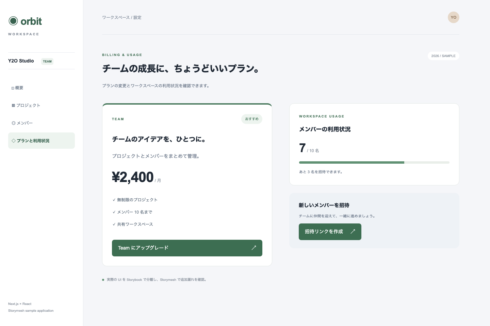

「招待リンクを作成」を押すと、React の state が更新され、利用人数が 7/10 から 8/10 に変わります。外部メール送信や課金処理はなく、画面内の操作デモです。

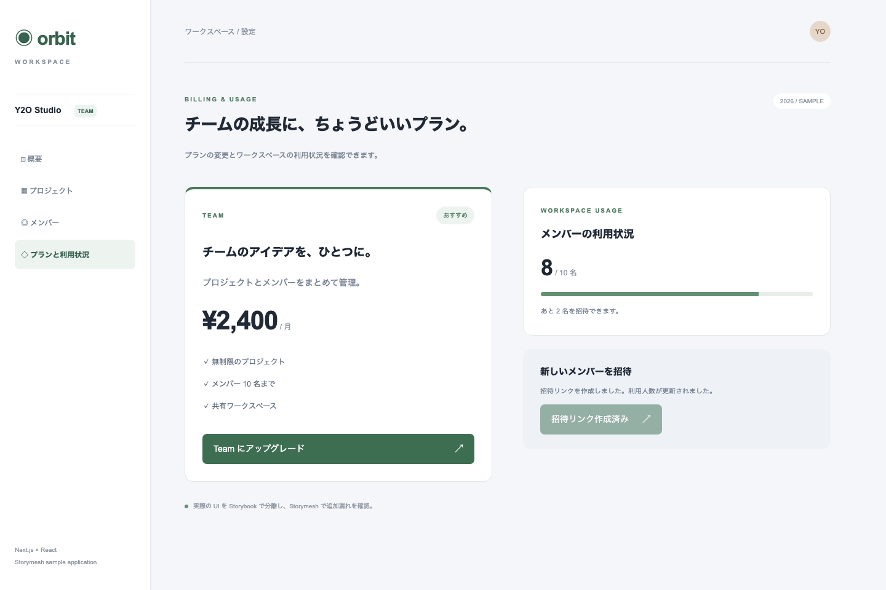

別のターミナルで Storybook を起動します。

```sh
cd examples/nextjs-storymesh
npm run storybook
```

`http://127.0.0.1:6006/?path=/story/components-plancard--default` を開くと、アプリと同じ PlanCard を単独で確認できます。

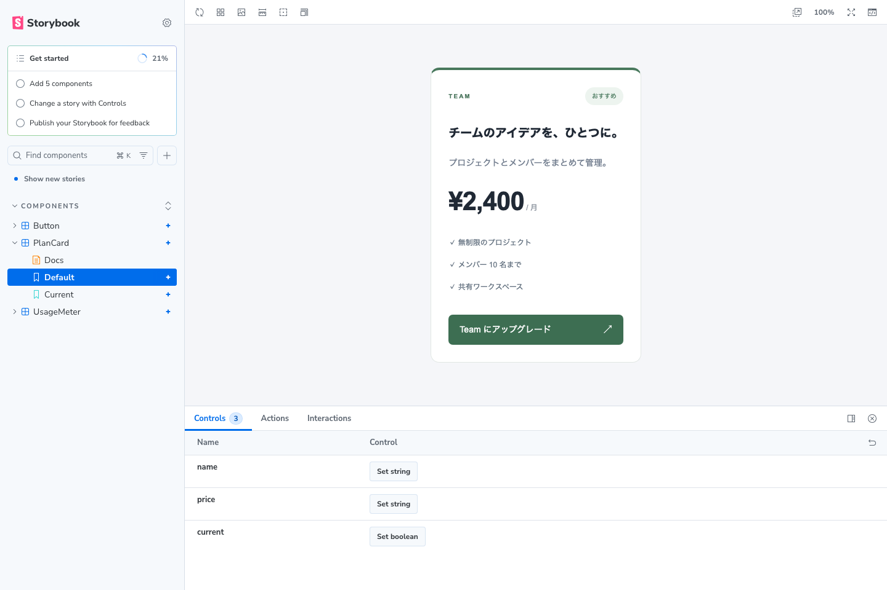

サンプルの URL は以下のとおりです。Next.js のページは `/` です。Storybook の URL はアプリのルートとは別です。

| URL | 内容 |
| --- | --- |
| `http://127.0.0.1:3000/` | プラン管理画面と招待操作 |
| `http://127.0.0.1:6006/?path=/story/components-button--default` | 通常ボタン |
| `http://127.0.0.1:6006/?path=/story/components-button--loading` | 処理中ボタン |
| `http://127.0.0.1:6006/?path=/story/components-button--disabled` | 無効ボタン |
| `http://127.0.0.1:6006/?path=/story/components-plancard--default` | おすすめプラン |
| `http://127.0.0.1:6006/?path=/story/components-plancard--current` | 利用中プラン |
| `http://127.0.0.1:6006/?path=/story/components-usagemeter--default` | 自動生成した Story |

## 2. 空のプロジェクトから導入する場合

このサンプルは App Router の最小構成を手動で作っています。新規プロジェクトなら、まず以下の依存を導入します。既存の Next.js プロジェクトでは Next.js / React の入れ直しは不要です。

```sh
mkdir nextjs-storymesh-demo
cd nextjs-storymesh-demo
npm init -y
npm install --save-exact next@16.4.0 react@19.2.7 react-dom@19.2.7
npm install --save-dev --save-exact typescript@6.0.2 \
  @types/node@24.13.2 @types/react@19.2.17 @types/react-dom@19.2.3
npm install --save-dev --save-exact storybook@10.6.2 \
  @storybook/nextjs-vite@10.6.2 @storybook/addon-docs@10.6.2
npm install --save-dev --save-exact storymesh@0.1.0
```

作成するファイル一式は [サンプル](../../../examples/nextjs-storymesh/) を参照してください。`src/app/layout.tsx` が HTML と CSS を、`src/app/page.tsx` が画面と操作を持ち、`src/components` に Storymesh の検査対象を置いています。`tsconfig.json`、`next-env.d.ts`、`next.config.ts`、npm scripts も同梱しています。

```text
nextjs-storymesh/
├── .storybook/
│   ├── main.ts
│   └── preview.ts
├── .storymesh/specs/Button.yaml
├── src/app/
│   ├── layout.tsx
│   ├── page.tsx
│   └── globals.css
├── src/components/
│   ├── Button.tsx / Button.stories.tsx
│   ├── PlanCard.tsx / PlanCard.stories.tsx
│   ├── UsageMeter.tsx / UsageMeter.stories.tsx
│   ├── .storymeshignore
│   ├── .storymesh-manual-ignore
│   └── generated/PreviewCard.tsx
├── scripts/
├── package.json
└── package-lock.json
```

Storybook の設定は以下です。

```ts
// .storybook/main.ts
import type { StorybookConfig } from '@storybook/nextjs-vite';
const config: StorybookConfig = {
  stories: ['../src/components/**/*.stories.@(ts|tsx)'],
  addons: ['@storybook/addon-docs'],
  framework: '@storybook/nextjs-vite',
};
export default config;
```

`.storybook/preview.ts` から `../src/app/globals.css` を import することで、アプリと同じスタイルで表示します。Next.js の手動導入は [Next.js 公式ドキュメント](https://nextjs.org/docs/app/getting-started/installation)、Vite を使う Storybook の統合は [Storybook 公式ドキュメント](https://storybook.js.org/docs/get-started/frameworks/nextjs-vite) を参考にしています。

Storymesh を開発依存に追加すると、次のように実行できます。以降の `--no-install` は、導入済みパッケージを使い、別の版を暗黙に取得しないために指定しています。

```sh
npx --no-install storymesh --version
npx --no-install storymesh --help
```

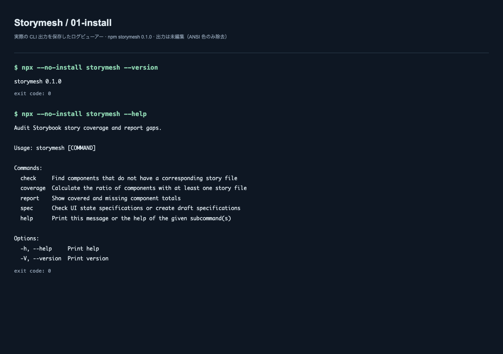

## 3. Story のないコンポーネントを検出する

同梱サンプルは完成状態です。不足のある状態へ戻すコマンドを用意しています。自作の Story を編集した後は、このリセットでデモ用ファイルが書き換わることに注意してください。

```sh
npm run demo:reset
npx --no-install storymesh check src/components --framework react
npx --no-install storymesh coverage src/components --framework react
npx --no-install storymesh report src/components --framework react
```

リセットは `UsageMeter.stories.tsx` を削除し、Button の `Loading` Story を取り除きます。Button と PlanCard には Story ファイルがあるため、結果は 2/3、66.7% です。

```text
Missing stories for 1 React component(s):
UsageMeter.tsx

React Storybook coverage: 66.7% (2/3 components)
```

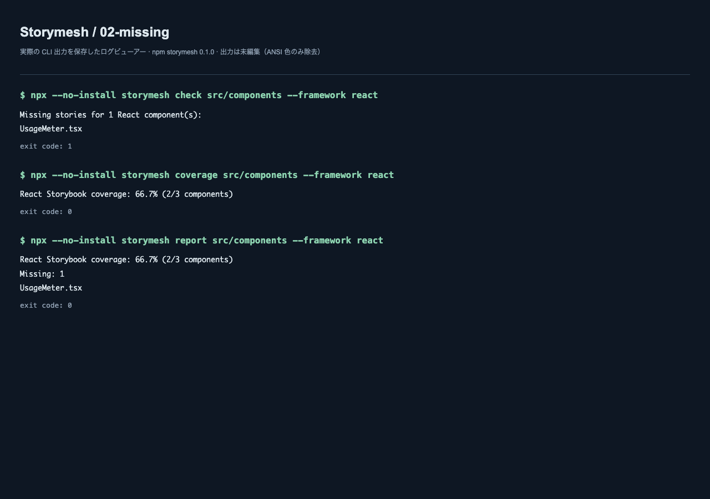

`check` は不足時に終了コード `1` を返します。`coverage` と `report` は不足があっても `0` です。CI で止める用途では `check` を使います。

Next.js の `page.tsx` や `layout.tsx` まで走査するとコンポーネントとして数えられる場合があるため、ここでは `src/components` に対象を絞っています。

## 4. 自動生成や対象外ファイルを除外する

検査ルートの `.storymeshignore` は自動的に読み込まれます。

```gitignore
# src/components/.storymeshignore
generated/
```

これにより、未対応の `generated/PreviewCard.tsx` は通常の 3 コンポーネントに数えません。追加の除外は引数またはファイルで指定できます。

```sh
npx --no-install storymesh check src/components --ignore 'UsageMeter.tsx'
npx --no-install storymesh check src/components --ignore-file .storymesh-manual-ignore
npx --no-install storymesh report src/components --ignore '!generated/PreviewCard.tsx'
```

最初の二つは UsageMeter を除外し、対象が 2/2 になります。最後は `!` で PreviewCard を再包含するため 2/4、50% になり、missing が二つ表示されます。割合が上がっても、Story を追加したわけではありません。

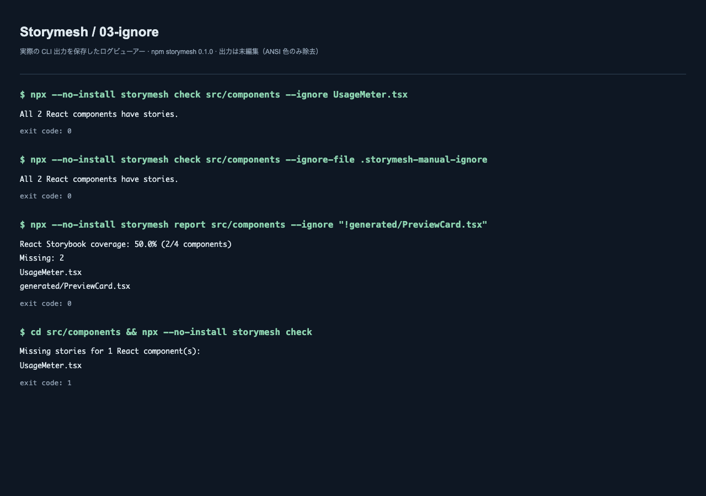

パターンと相対 `--ignore-file` は検査ルートから解決されます。`--ignore` / `--ignore-file` は繰り返し指定できます。`**/*.fixture.tsx` などの glob、コメント、空行、`!` を使えます。PATH を省略すると現在のディレクトリ、フレームワークを省略すると React を使います。上の画像の最後の実行は `src/components` に移動したうえで引数を省略しています。

## 5. 不足する Story を生成する

```sh
npx --no-install storymesh check src/components --framework react --generate
npx --no-install storymesh check src/components
npx --no-install storymesh coverage src/components
```

実際に `UsageMeter.stories.tsx` が作られます。

```tsx
import { UsageMeter as Component } from './UsageMeter';

const meta = {
  title: 'Components/UsageMeter',
  component: Component,
};

export default meta;

export const Default = {};
```

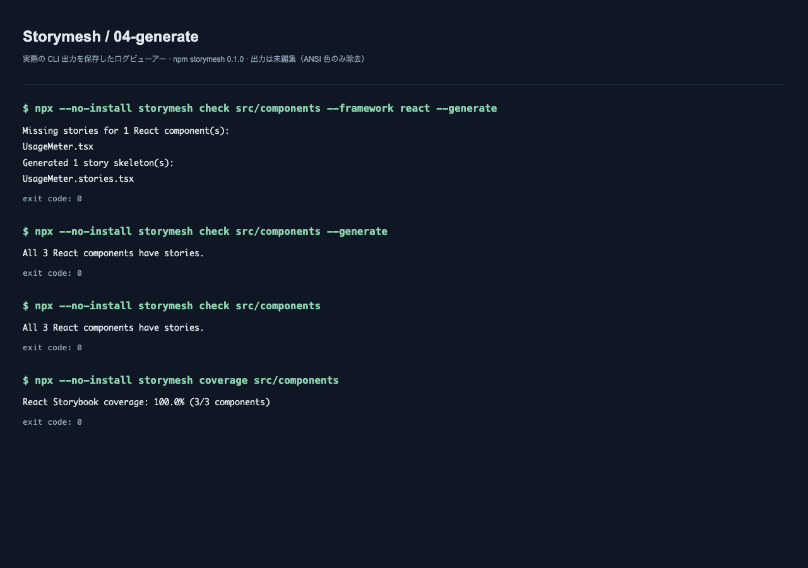

再実行しても既存ファイルを上書きしません。この例は props にデフォルト値があるので、生成物のまま描画できます。必須 props があるコンポーネントでは、生成後に `args` や `render` を補います。

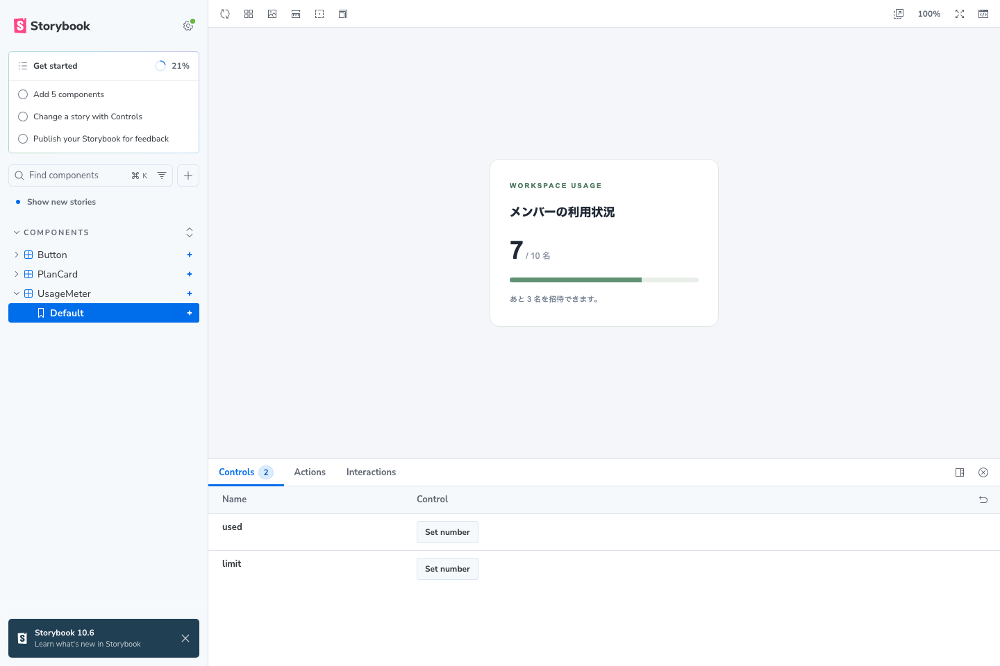

`--generate` の終了コードは生成処理の成否です。生成できれば `0`、失敗すれば `2`。不足を CI で検出したいコマンドに `--generate` を付けると、不足があっても成功扱いになるため、生成と検査を分けます。

## 6. ファイルがあっても Loading 状態が足りない場合

ファイル coverage が 100% でも Button の Loading はまだありません。必要な UI 状態を `.storymesh/specs/Button.yaml` に書きます。

```yaml
version: 1
component:
  id: button
  name: Button
  title: Components/Button
stories:
  - id: default
    required: true
  - id: loading
    required: true
  - id: disabled
    required: false
```

`title` は Storybook の title と完全一致させます。Story ID は Storybook index の `name` を小文字にし、空白・`_`・`-` の連続を `-` にしたものです。`required: false` は任意状態で、存在しても警告にしません。

同じ checkout から index を生成して検査します。Storybook 10.6.2 の `index -o` は出力先の親ディレクトリを作らないため、先に作成します。同梱の `npm run storybook:index` はこの準備も行います。

```sh
mkdir -p storybook-static
npx --no-install storybook index -o storybook-static/index.json
npx --no-install storymesh spec check \
  --spec-dir .storymesh/specs --index storybook-static/index.json
```

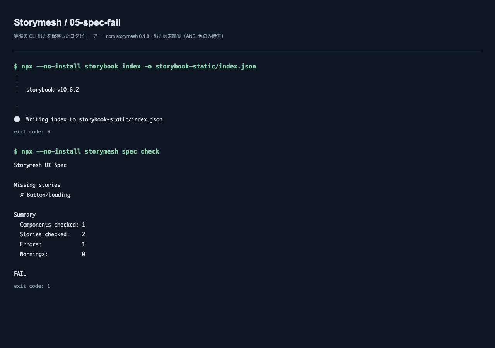

`Button/loading` が不足し、終了コード `1` で FAIL になります。Button に次の Story を追加します。

```tsx
export const Loading: Story = {
  args: { loading: true, children: 'プランを選択' },
};
```

サンプルでは `npm run demo:complete` でも完成状態にできます。その後に **index を再生成** します。

```sh
npm run demo:complete
npm run storybook:index
npm run storymesh:spec
```

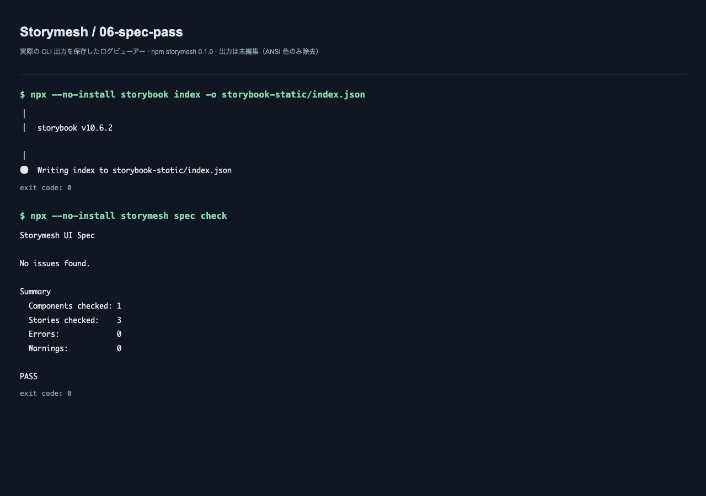

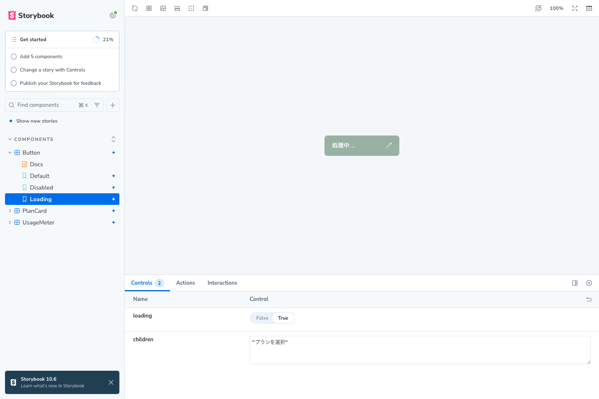

利用中プランも別の Story として描画できます。

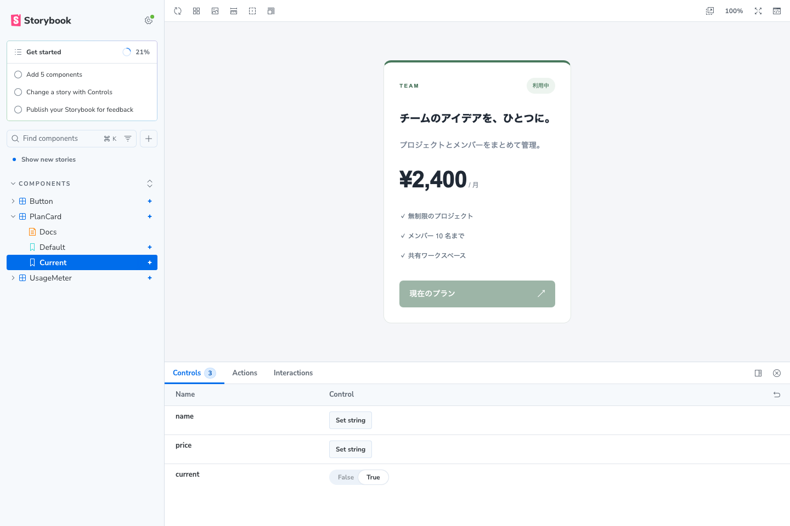

Spec 検査が保証するのは登録の有無です。今回はブラウザで Loading の表示と disabled、アプリの招待操作を別途検証しました。Storymesh 自体は描画、args、クリック結果、アクセシビリティや視覚差分の正しさを保証しません。

## 7. Spec の下書きを作る `spec init`

既存のコンポーネントから YAML のたたき台を作れます。

```sh
npx --no-install storymesh spec init src/components --framework react \
  --spec-dir .demo/drafts
```

通常の生成物は `stories: []` です。そのまま `spec check` すると下書きとして終了コード `2` になります。必要な状態を埋めてから使います。

まだ Story がないコンポーネントなら、`--with-stories` で Default Story と、それを required とする Spec を一緒に作れます。

```sh
mkdir -p .demo/fresh
# FreshCard.tsx を作成してから実行する
npx --no-install storymesh spec init .demo/fresh --framework react \
  --with-stories --spec-dir .demo/fresh-specs
```

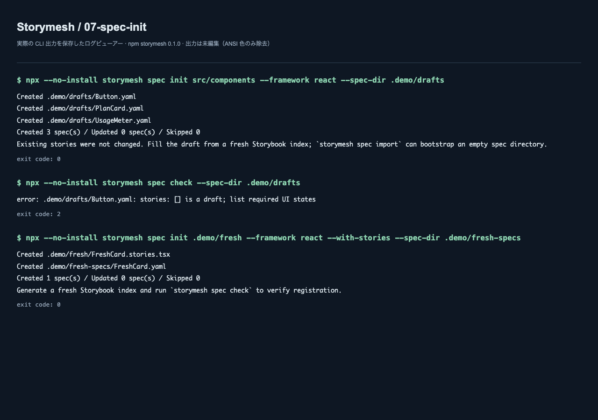

今回は他のデモと混ざらない `.demo/fresh` で生成を確認しました。このパスは `.storybook/main.ts` の glob の外なので、FreshCard は本編の Storybook には登録していません。実際に使う際は Storybook が読むパスへ配置し、index を作り直して検査してください。生成した [YAML](evidence/fresh-specs/FreshCard.yaml) と [CSF](evidence/FreshCard.generated.txt) も保存しています。既存 Story は `--with-stories` でも編集されず、下書き Spec が作られます。

## 8. 既存の Storybook から Spec を作る `spec import`

```sh
npx --no-install storymesh spec import \
  --index storybook-static/index.json --spec-dir .demo/imported
```

index の Story を title ごとに YAML へ変換します。Docs entry は required Story に数えません。再実行しても既存 Spec はスキップされます。

新しい Story を既存 Spec に追加する際は `--merge` を使います。

```sh
npx --no-install storymesh spec import \
  --index storybook-static/index.json --spec-dir .demo/imported --merge
```

**今回確認した公開 npm 版 0.1.0 の注意点:** `spec import` はリストのハイフンをインデントしない YAML を生成しましたが、`--merge` はその形式を受け付けず終了コード `2` になりました。以下のように `stories` 配下を 2 スペース下げると成功します。内容や `required` の値は変えません。

```yaml
# import 直後
stories:
- id: default
  required: true

# merge の前に整形
stories:
  - id: default
    required: true
```

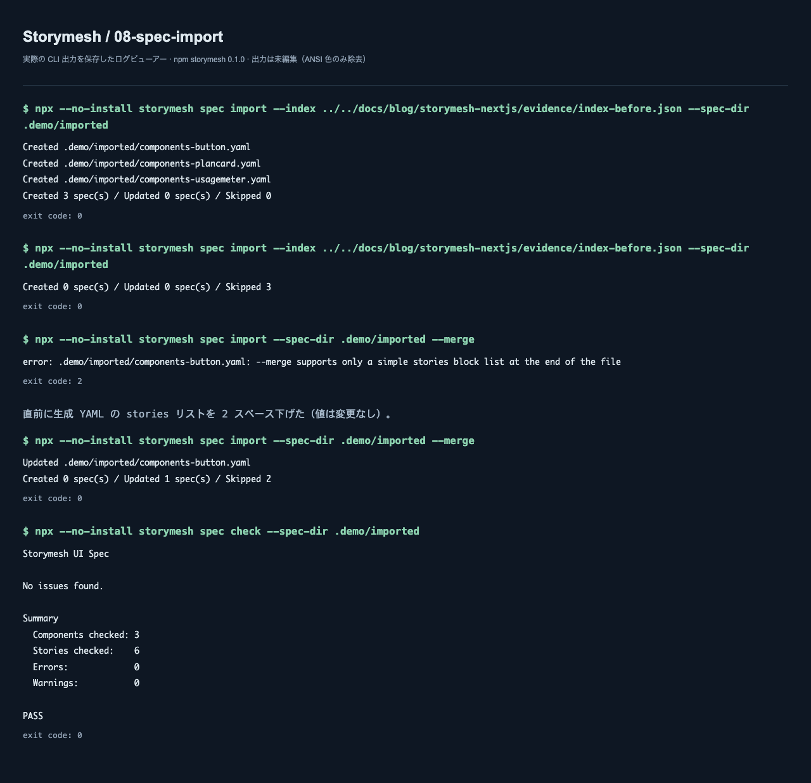

今回の実演では Loading のない [index-before.json](evidence/index-before.json) を import し、インデントを整えてから、Loading がある [index-after.json](evidence/index-after.json) 相当の新しい index で merge しました。結果は `Updated 1 spec(s)`。新しい Loading が追加され、3 コンポーネント・6 Story の Spec 検査が PASS になりました。[整形前](evidence/imported-original/) と [merge 後](evidence/imported/) の YAML を保存しています。

merge は単純な v1 のブロック形式で、末尾にある `stories` リストが対象です。anchor、alias、フロー形式、複数ドキュメントなどは対象外です。既存コメントや `required` は保持する設計なので、任意状態を全て必須に戻す必要はありません。ここでは実行した形式と結果を掲載し、その他の形式の互換性は主張していません。

## 9. WARNING、FAIL、入力エラーを見分ける

Spec から Disabled の宣言だけを取り除くと、Storybook にある `Button/disabled` が宣言外の状態として WARNING になります。警告だけなら PASS / `0` です。

存在しない index を指定すると入力エラー / `2` で、PASS は出ません。

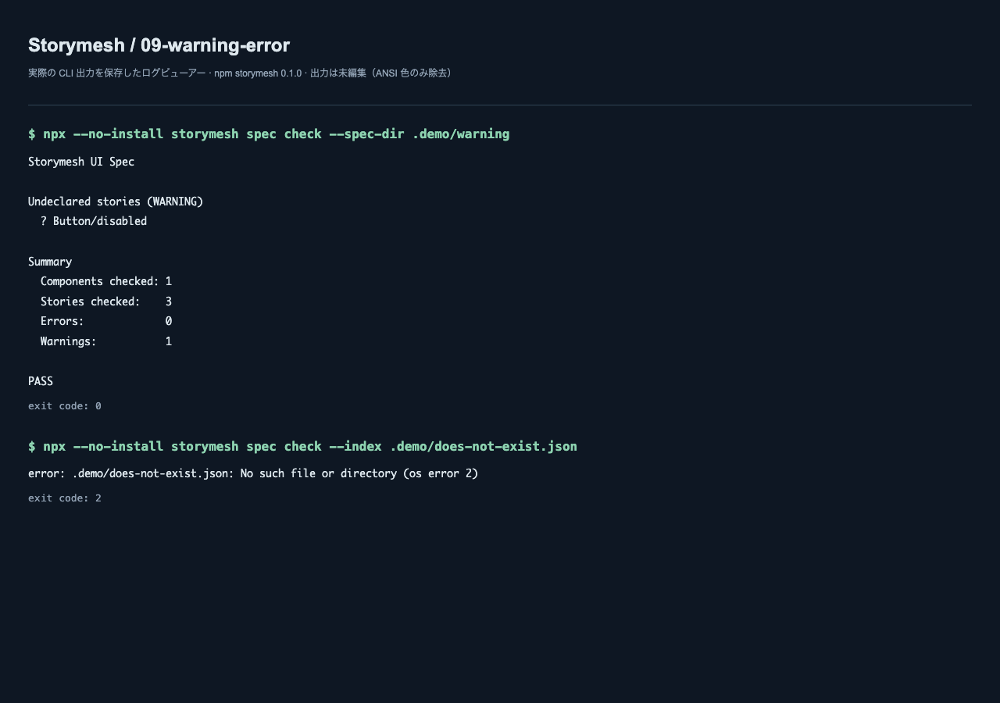

| 終了コード | 意味と使い分け |
| --- | --- |
| `0` | `check` / `spec check` は不足なし。警告だけの Spec も成功。生成は正常終了 |
| `1` | Story ファイル、または required Story が不足 |
| `2` | 入力不正、空の Spec 下書き、読み書きや生成の失敗など |

## 10. CI で追加漏れを防ぐ

同梱サンプルでは次のコマンドを CI のステップにできます。

```sh
npm ci
npm run typecheck
npm run storymesh:check
npm run storybook:index
npm run storymesh:spec
```

GitHub Actions なら、サンプルがリポジトリ内の `examples/nextjs-storymesh` にある場合、次のように対象ディレクトリを指定します。これは掲載用の設定例で、リモートの CI を実行したスクリーンショットではありません。ローカルでは同じ検査の失敗と成功を確認しています。

```yaml
name: Story coverage
on: [push, pull_request]
jobs:
  stories:
    runs-on: ubuntu-latest
    defaults:
      run:
        working-directory: examples/nextjs-storymesh
    steps:
      - uses: actions/checkout@v4
      - uses: actions/setup-node@v4
        with:
          node-version: '24'
          cache: npm
          cache-dependency-path: examples/nextjs-storymesh/package-lock.json
      - run: npm ci
      - run: npm run typecheck
      - run: npm run storymesh:check
      - run: npm run storybook:index
      - run: npm run storymesh:spec
```

## 向いているユースケースと検査範囲

| ユースケース | コマンド | このサンプルの証拠 |
| --- | --- | --- |
| 新規 UI の Story 書き忘れ | `check` | UsageMeter が missing、終了コード 1 |
| チームの Story 整備状況を確認 | `coverage` / `report` | 66.7% → 100% |
| missing の作業開始を早める | `check --generate` | CSF を生成し、Storybook で実描画 |
| 自動生成コードを管理対象から外す | ignore 設定 | PreviewCard を除外、`!` で再包含 |
| 必須 UI 状態の漏れを防ぐ | `spec check` | Loading 不足で FAIL、追加後 PASS |
| UI 状態の要求を下書きにする | `spec init` / `--with-stories` | YAML、Default CSF の生成 |
| 既存 Storybook を Spec 管理へ移す | `spec import` / `--merge` | import / skip / 整形後 merge |
| 定義と実装のずれを検知 | `spec check` | Disabled の宣言漏れ WARNING |
| PR で追加漏れを止める | npm scripts + CI | ローカルで終了コード 0 / 1 / 2 を確認 |

React の Story はコンポーネントと同じディレクトリ、または直下の `stories` / `__stories__` から同名で対応付けます。MDX はファイル coverage に含まれません。`.next`、`node_modules` などは走査対象外です。ファイル名を中心とした検査のため、別名の Story や非コンポーネントの TSX は注意が必要です。

Storymesh は Vue / Angular にも対応していますが、この記事の実動検証は Next.js / React です。他フレームワークでの成功画像として流用しないでください。

## 資料と画像を再生成する

```sh
cd examples/nextjs-storymesh
npm ci
npm run demo:exercise
npm run typecheck
npm run build
npm run build-storybook -- --disable-telemetry
```

`demo:exercise` は不足 → 生成 → Spec 不足 → 修正 → init/import/merge → warning/error の順で実行し、27 コマンドの期待終了コードを確認します。最後は完成状態です。`.demo/` はこのスクリプトの作業領域で、毎回作り直されます。

撮影時は別ターミナルで `npm run start`（3000）と `npm run storybook -- --disable-telemetry`（6006）を起動し、次を実行します。

```sh
npx --no-install playwright install chromium
npm run demo:capture
```

PNG、ログビューアー HTML、ブラウザ検証記録をこの資料ディレクトリに出力します。ポートを使う他のアプリがある場合は停止するか、撮影スクリプトと起動ポートを揃えてください。画像とキャプションの一覧は [screenshots.md](screenshots.md)、検証内容は [verification.md](verification.md) にまとめています。
